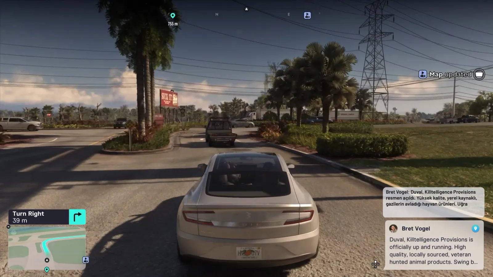
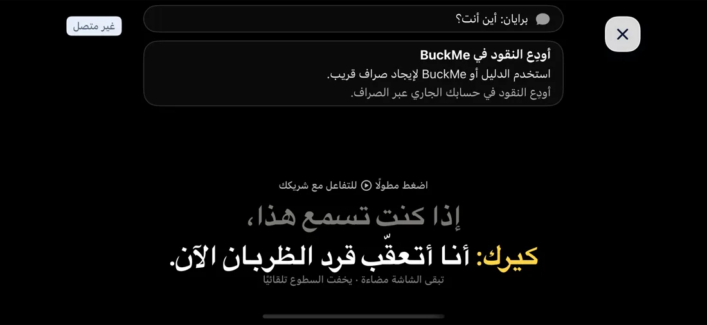
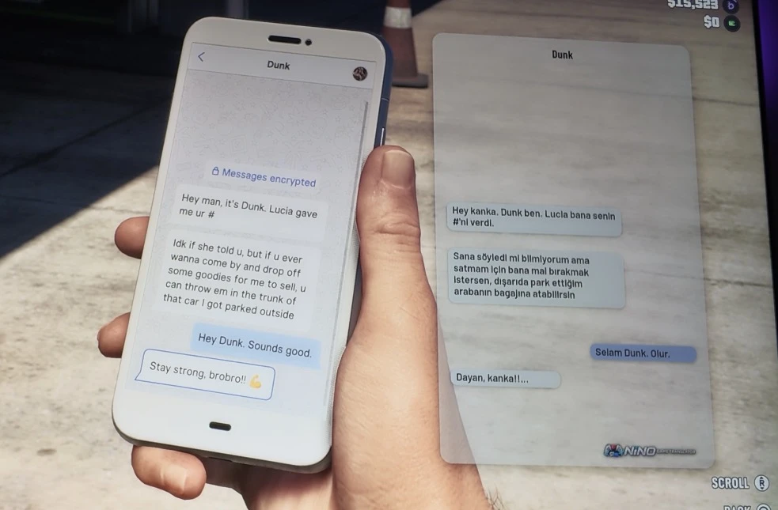
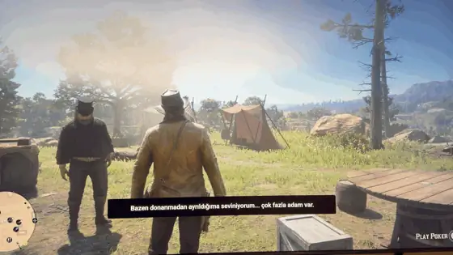

<div dir="rtl" lang="ar">

<p align="center">
  
</p>

<h1 align="center">Nino Game Translator</h1>

<p align="center"><b>اللعبة بالإنجليزية، والترجمة بالعربية، على شاشة تلفازك فوق اللعبة مباشرةً.</b></p>

<p align="center">
  <a href="README.md">Türkçe</a> · <b>العربية</b> · <a href="README.en.md">English</a>
</p>

<p align="center">مجاني · بلا إعلانات · بلا حساب · مفتوح المصدر</p>

---

## ما هو Nino Game Translator؟

يحوّل النصوص الإنجليزية في ألعابك إلى **العربية**.

- الحوارات ورسائل الهاتف والمهام والخريطة: كلها مترجمة.
- تظهر الترجمة **على التلفاز فوق اللعبة**.
- يعمل مع **PS5** و **Xbox**. مجاني.

## كيف يبدو؟

<p align="center"><sub>الصور من النسخة التركية؛ والترجمة العربية تظهر بالطريقة نفسها تمامًا.</sub></p>

<p align="center">
  
  <br><sub>رسالة تصل داخل اللعبة، وترجمتها فوقها مباشرةً.</sub>
</p>

<p align="center">
  
  <br><sub><b>رسائل الهاتف</b><br>على iPhone بالوضع الأفقي: الرسائل في الأعلى والترجمة في الوسط.</sub>
</p>

<p align="center">
  
  <br><sub><b>بطاقة الخريطة</b><br>بطاقة المهمة في الأعلى، فتعرف المطلوب بنظرة واحدة.</sub>
</p>

<p align="center">
  
  <br><sub><b>بجانب هاتف اللعبة</b><br>الرسائل تظهر في لوحة مرتّبة على الجانب.</sub>
</p>

<p align="center">
  
  <br><sub><b>Mac ↔ iPhone</b><br>Nino Game Translator نفسه وبالسهولة نفسها على كل جهاز.</sub>
</p>

<p align="center">
  
  <br><sub>من تلفاز حقيقي: Red Dead Redemption 2 · <a href="docs/img/rdr2-turkce-altyazi.mp4">▶️ فيديو بالصوت (30 ثانية)</a></sub>
</p>

## ابدأ في 3 خطوات

1. **نزّل Nino Game Translator:** اختر جهازك من الجدول أدناه.
2. **اربط جهاز اللعب:** PS5 أو Xbox، على شبكة Wi-Fi نفسها. لـ PS5 تحتاج إلى حساب PSN ثانٍ مجاني. يخبرك Nino Game Translator بما تفعله خطوة بخطوة.
3. **اختر تلفازك:** يثبّت Nino Game Translator تطبيق التلفاز بنفسه.

ثم شغّل اللعبة، وفي Nino Game Translator اسحب القابس 🔌 إلى المقبس لتبدأ الترجمة. هذا كل شيء.

## التحميل

<p><a href="https://github.com/yunusdemirbag/nino-game-translator/releases/latest"></a></p>

| الجهاز | التحميل | طريقة التثبيت |
|---|---|---|
| Mac | [Nino-Mac.zip](https://github.com/yunusdemirbag/nino-game-translator/releases/latest/download/Nino-Mac.zip) | [التثبيت ↓](#setup-mac) |
| Windows | [Nino-Windows-Setup.exe](https://github.com/yunusdemirbag/nino-game-translator/releases/latest/download/Nino-Windows-Setup.exe) | [التثبيت ↓](#setup-windows) |
| iPhone و iPad | [TestFlight (نسخة تجريبية من Apple)](https://testflight.apple.com/join/1K3Q1KXp) | [التثبيت ↓](#setup-iphone) |
| هاتف Android | [Nino-Telefon.apk (ملف تثبيت)](https://github.com/yunusdemirbag/nino-game-translator/releases/latest/download/Nino-Telefon.apk) | [التثبيت ↓](#setup-android) |
| التلفاز (Android TV و LG و Samsung) | يثبّته Nino Game Translator بنفسه | [التثبيت ↓](#setup-tv) |
| Linux (للمستخدمين المتقدمين) | عبر Docker | [التثبيت ↓](#setup-linux) |

كل الملفات: [صفحة إصدار Nino Game Translator](https://github.com/yunusdemirbag/nino-game-translator/releases/latest)

## التثبيت

<a id="setup-mac"></a>
### Mac
1. نزّل **Nino-Mac.zip** وانقر عليه مرتين.
2. اسحب **Nino** إلى مجلد **التطبيقات** وافتحه.
3. إذا ظهر أنه لا يمكن فتحه: **إعدادات النظام ← الخصوصية والأمان ← فتح على أي حال**.

<a id="setup-windows"></a>
### Windows
1. نزّل **Nino-Windows-Setup.exe** وانقر عليه مرتين.
2. إذا ظهرت رسالة "Windows protected your PC": **More info › Run anyway**.
3. يفتح Nino Game Translator تلقائيًا.

<a id="setup-iphone"></a>
### iPhone و iPad
1. ثبّت **TestFlight** من App Store.
2. اضغط [هذا الرابط](https://testflight.apple.com/join/1K3Q1KXp) ثم **قبول ← تثبيت**.
3. افتح Nino Game Translator. (نسخة App Store قريبًا.)

<a id="setup-android"></a>
### هاتف Android
1. نزّل **Nino-Telefon.apk** على هاتفك وافتحه.
2. إذا ظهرت رسالة "تثبيت التطبيقات غير المعروفة"، فعّل **السماح من هذا المصدر** ثم ارجع.
3. اضغط **تثبيت** ثم افتح Nino Game Translator.

<a id="setup-tv"></a>
### التلفاز
لا حاجة لتنزيل أي شيء: اختر تلفازك في Nino Game Translator وسيثبّت التطبيق عليه بنفسه.
للتثبيت اليدوي: [Android TV](https://github.com/yunusdemirbag/nino-game-translator/releases/latest/download/Nino-TV.apk) · [LG](https://github.com/yunusdemirbag/nino-game-translator/releases/latest/download/Nino-TV.ipk) · [Samsung](https://github.com/yunusdemirbag/nino-game-translator/releases/latest/download/Nino-TV.wgt)

<a id="setup-linux"></a>
### Linux
تعمل نسخة Linux عبر Docker (يجب أن يكون Docker مثبتًا). الصق هذين السطرين في الطرفية:
```bash
curl -fsSLO https://raw.githubusercontent.com/yunusdemirbag/nino-game-translator/main/apps/linux/docker-compose.yml
docker compose up -d
```
ثم افتح في المتصفح `http://localhost:8788`. من جهاز آخر استبدل `localhost` بعنوان جهاز Linux في شبكتك (مثل `http://192.168.1.20:8788`).

## على أي تلفاز يعمل؟

✅ يعمل مع: **Android TV / Google TV** و **Samsung** و **LG**، وكذلك شاشة الكمبيوتر.

❌ لا يعمل مع: Hisense (Vidaa) وأجهزة Philips الجديدة (Titan OS) و TiVo، وأجهزة التلفاز القديمة التي لا تعمل بنظام Android.
مع هذه التلفزيونات، اعرض الترجمة على شاشة Mac أو الكمبيوتر. أو أدِر هاتفك أفقيًا: تظهر الترجمة على الهاتف.

## أسئلة

**هل هو مدفوع؟** لا. مجاني تمامًا وبلا إعلانات.

**لماذا أحتاج إلى حساب PSN ثانٍ؟** لا يسمح PS5 بالاتصال بالحساب الذي تلعب به في الوقت نفسه. يكفي حساب ثانٍ مجاني.

**لا يظهر شيء على التلفاز؟** تأكد أن جهاز اللعب (PS5 أو Xbox) والجهاز الذي يعمل عليه Nino Game Translator والتلفاز متصلة كلها بشبكة Wi-Fi نفسها. أعد تشغيل Nino Game Translator.

**أي ألعاب؟** تقريبًا كل لعبة فيها نص إنجليزي. ولـ GTA 6 دعم خاص.

المزيد: [الأسئلة الشائعة](docs/SSS.ar.md) · اسأل: [Issues](https://github.com/yunusdemirbag/nino-game-translator/issues)

## الخصوصية

لا تحتاج إلى حساب. صورة شاشة لعبتك لا تُرسَل إلى أي جهة. [سياسة الخصوصية (بالتركية والإنجليزية)](PRIVACY.md)

## من يصنعه؟

- **Yunus Demirbağ**: يصمّم Nino Game Translator ويطوّره.
- **M. Akif Demirbağ**: يدعم ويجرّب ويقترح الأفكار.

Nino Game Translator مفتوح المصدر ([AGPL-3.0](LICENSE))؛ يمكن لأي شخص قراءة الكود.
وجدت خطأً أو لديك فكرة؟ اكتب في [Issues](https://github.com/yunusdemirbag/nino-game-translator/issues)، نقرأ كل شيء.
إذا أعجبك Nino Game Translator، فإن ⭐ في أعلى اليمين تساعدنا كثيرًا.

---

<sub>لا يرتبط Nino Game Translator بشركات Sony أو Microsoft أو LG أو Samsung. أسماء PlayStation و PS5 و Xbox و LG و Samsung علامات تجارية لأصحابها، وصور الألعاب ملك لأصحابها.</sub>

<p align="center">شكرًا جزيلًا لبرنامج <b>CouchSubs</b> ومطوّره <b>Sinan Yorulmaz</b>، فقد ألهما إصداراتنا الأولى.</p>


</div>
