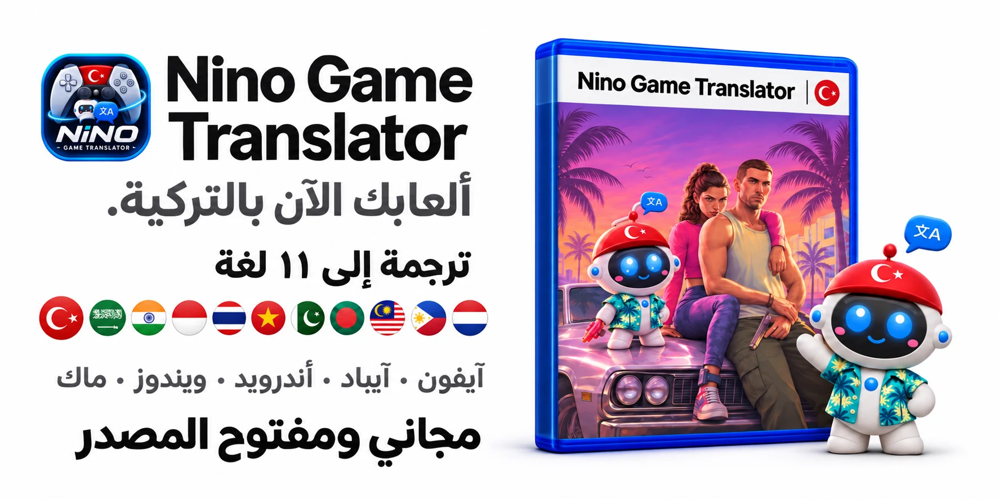
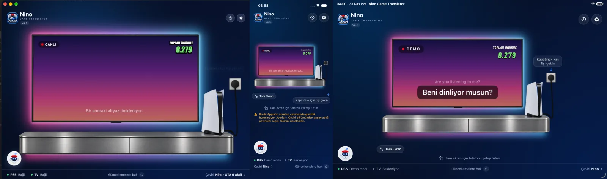

<div dir="rtl" lang="ar">

<p align="center">
  
</p>

<h1 align="center">Nino Game Translator</h1>

<p align="center"><b>اللعبة بالإنجليزية، والترجمة بالعربية، على شاشة تلفازك فوق اللعبة مباشرةً.</b></p>

<p align="center">
  <a href="README.md">Türkçe</a> · <b>العربية</b> · <a href="README.en.md">English</a>
</p>

<p align="center">مجاني · بلا إعلانات · بلا حساب · مفتوح المصدر</p>

---

## ما هو Nino؟

يترجم Nino النصوص الإنجليزية في ألعاب PS5 و Xbox إلى العربية أو التركية في اللحظة نفسها.
يترجم الحوارات، ورسائل الهاتف داخل اللعبة، وبطاقات المهام والخريطة.
تظهر الترجمة على التلفاز فوق اللعبة، وأنت تلعب كعادتك.

## كيف يبدو؟

<p align="center">
  
  <br><sub>رسالة تصل داخل اللعبة، وترجمتها فوقها مباشرةً.</sub>
</p>

<p align="center">
  
  <br><sub><b>رسائل الهاتف</b><br>على iPhone بالوضع الأفقي: الرسائل في الأعلى والترجمة في الوسط.</sub>
</p>

<p align="center">
  
  <br><sub><b>بطاقة الخريطة</b><br>بطاقة المهمة في الأعلى، فتعرف المطلوب بنظرة واحدة.</sub>
</p>

<p align="center">
  
  <br><sub><b>بجانب هاتف اللعبة</b><br>الرسائل تظهر في لوحة مرتّبة على الجانب.</sub>
</p>

<p align="center">
  
  <br><sub><b>Mac ↔ iPhone</b><br>Nino نفسه وبالسهولة نفسها على كل جهاز.</sub>
</p>

<p align="center">
  
  <br><sub>من تلفاز حقيقي: Red Dead Redemption 2 · <a href="docs/img/rdr2-turkce-altyazi.mp4">▶️ فيديو بالصوت (30 ثانية)</a></sub>
</p>

## ابدأ في 3 خطوات

1. **نزّل Nino:** اختر جهازك من الجدول أدناه.
2. **اربط جهازك:** PS5 أو Xbox. يخبرك Nino بما تفعله خطوة بخطوة.
3. **اختر تلفازك:** يثبّت Nino تطبيق التلفاز بنفسه.

ثم شغّل اللعبة وأدخل قابس Nino. هذا كل شيء.

## التحميل

| الجهاز | التحميل | طريقة التثبيت |
|---|---|---|
| Mac | [Nino-Mac.zip](https://github.com/yunusdemirbag/nino-game-translator/releases/latest/download/Nino-Mac.zip) | [التثبيت ↓](#setup-mac) |
| Windows | [Nino-Windows-Setup.exe](https://github.com/yunusdemirbag/nino-game-translator/releases/latest/download/Nino-Windows-Setup.exe) | [التثبيت ↓](#setup-windows) |
| iPhone و iPad | [TestFlight](https://testflight.apple.com/join/1K3Q1KXp) | [التثبيت ↓](#setup-iphone) |
| هاتف Android | [Nino-Telefon.apk](https://github.com/yunusdemirbag/nino-game-translator/releases/latest/download/Nino-Telefon.apk) | [التثبيت ↓](#setup-android) |
| التلفاز (Android TV و LG و Samsung) | يثبّته Nino بنفسه | [التثبيت ↓](#setup-tv) |
| Linux | Docker | [التثبيت ↓](#setup-linux) |

## التثبيت

<a id="setup-mac"></a>
### Mac
1. نزّل **Nino-Mac.zip** وانقر عليه مرتين.
2. اسحب **Nino** إلى مجلد **التطبيقات** وافتحه.
3. إذا ظهر أنه لا يمكن فتحه: **إعدادات النظام › الخصوصية والأمان › فتح على أي حال**.

<a id="setup-windows"></a>
### Windows
1. نزّل **Nino-Windows-Setup.exe** وانقر عليه مرتين.
2. إذا ظهرت رسالة "Windows protected your PC": **More info › Run anyway**.
3. يفتح Nino تلقائيًا.

<a id="setup-iphone"></a>
### iPhone و iPad
1. ثبّت **TestFlight** من App Store.
2. اضغط [هذا الرابط](https://testflight.apple.com/join/1K3Q1KXp) ثم **قبول › تثبيت**.
3. افتح Nino. (نسخة App Store قريبًا.)

<a id="setup-android"></a>
### هاتف Android
1. نزّل **Nino-Telefon.apk** على هاتفك وافتحه.
2. إذا طُلب إذن التطبيقات غير المعروفة، اضغط **سماح**.
3. اضغط **تثبيت** ثم افتح Nino.

<a id="setup-tv"></a>
### التلفاز
لا حاجة لتنزيل أي شيء: اختر تلفازك في Nino وسيثبّت التطبيق عليه بنفسه.
للتثبيت اليدوي: [Android TV](https://github.com/yunusdemirbag/nino-game-translator/releases/latest/download/Nino-TV.apk) · [LG](https://github.com/yunusdemirbag/nino-game-translator/releases/latest/download/Nino-TV.ipk) · [Samsung](https://github.com/yunusdemirbag/nino-game-translator/releases/latest/download/Nino-TV.wgt)

<a id="setup-linux"></a>
### Linux
```bash
curl -fsSLO https://raw.githubusercontent.com/yunusdemirbag/nino-game-translator/main/apps/linux/docker-compose.yml
docker compose up -d
```
ثم افتح `http://<عنوان الجهاز>:8788` في المتصفح.

كل الملفات: [صفحة إصدار Nino](https://github.com/yunusdemirbag/nino-game-translator/releases/latest)

## على أي تلفاز يعمل؟

**يعمل على**
- Android TV و Google TV (ومعها أجهزة Android TV الخارجية)
- Samsung (Tizen)
- LG (webOS)
- شاشة Mac أو الكمبيوتر
- الشاشة العادية (عبر بطاقة HDMI أو شاشة الكمبيوتر)

**لا يعمل على**
- Vidaa (معظم أجهزة Hisense)
- TiVo
- Titan OS (أجهزة Philips الجديدة)
- Axen
- أجهزة Vestel القديمة غير العاملة بنظام Android
- أجهزة التلفاز الخارجية غير العاملة بنظام Android

هذه الأجهزة لا تقبل تثبيت تطبيقات إضافية. الحل: وصّل جهاز Android TV بالتلفاز، أو اعرض الترجمة على شاشة الكمبيوتر.

## أسئلة متكرّرة

**هل أدفع شيئًا؟**\
لا. Nino مجاني بالكامل، بلا إعلانات ولا اشتراك.

**لماذا أحتاج إلى حساب PSN ثانٍ؟**\
لا يسمح PS5 بالاتصال عن بُعد بالحساب نفسه الذي تلعب به في الوقت ذاته. يكفي حساب ثانٍ مجاني.

**الترجمة لا تظهر على التلفاز، ماذا أفعل؟**\
تأكّد أن الجهاز و Nino والتلفاز على شبكة الواي فاي نفسها، ثم أغلق Nino وتطبيق التلفاز وافتحهما من جديد.

**مع أي الألعاب يعمل؟**\
مع أغلب الألعاب التي فيها نص إنجليزي على الشاشة، ولـ GTA 6 دعم خاص.

**هل يعمل مع Xbox؟**\
نعم، وهو ما زال تجريبيًا. يكفي حساب Microsoft الخاص بك.

المزيد: [الأسئلة المتكرّرة](docs/SSS.ar.md)

## الخصوصية

- لا تحتاج إلى إنشاء حساب.
- مفتاح خدمة الترجمة (مفتاح API) يبقى على جهازك فقط، ولا يُرسل إلى خادمنا.
- صورة اللعبة لا تُحفظ ولا تُرسل إلى أي مكان.

التفاصيل: [سياسة الخصوصية](PRIVACY.md)

## الترخيص والتواصل

Nino مفتوح المصدر بترخيص [AGPL-3.0](LICENSE).
للأسئلة والاقتراحات: [GitHub › Issues](https://github.com/yunusdemirbag/nino-game-translator/issues)

تطوير: **Yunus Demirbağ** · بدعم من: **M. Akif Demirbağ**

شكرًا جزيلًا لبرنامج **CouchSubs** ومطوّره **Sinan Yorulmaz**، فقد ألهما إصداراتنا الأولى.

<sub>لا يرتبط Nino بشركات Sony أو Microsoft أو LG أو Samsung. أسماء PlayStation و PS5 و Xbox و LG و Samsung علامات تجارية لأصحابها، وصور الألعاب ملك لأصحابها.</sub>

</div>
