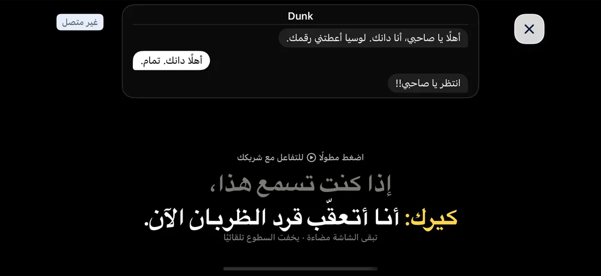

  

<h1 align="center">Nino Game Translator</h1>

<b>اللعبة بالإنجليزية، والترجمة بالعربية، على شاشة تلفازك فوق اللعبة مباشرةً.</b>

  <a href="README.md">Türkçe</a> · <b>العربية</b> · <a href="README.en.md">English</a>

مجاني · بلا إعلانات · بلا حساب · مفتوح المصدر

---

## ما هو Nino؟

يترجم Nino النصوص الإنجليزية في ألعاب PS5 و Xbox إلى العربية أو التركية في اللحظة نفسها.
يترجم الحوارات، ورسائل الهاتف داخل اللعبة، وبطاقات المهام والخريطة.
تظهر الترجمة على التلفاز فوق اللعبة، وأنت تلعب كعادتك.

## كيف يبدو؟

  
   رسالة تصل داخل اللعبة، وترجمتها فوقها مباشرةً.

<table>
  <tr>
    <td width="50%" align="center">
       
      <b>رسائل الهاتف</b> على iPhone بالوضع الأفقي: الرسائل في الأعلى والترجمة في الوسط.
    </td>
    <td width="50%" align="center">
       
      <b>بطاقة الخريطة</b> بطاقة المهمة في الأعلى، فتعرف المطلوب بنظرة واحدة.
    </td>
  </tr>
  <tr>
    <td width="50%" align="center">
       
      <b>بجانب هاتف اللعبة</b> الرسائل تظهر في لوحة مرتّبة على الجانب.
    </td>
    <td width="50%" align="center">
       
      <b>Mac ↔ iPhone</b> Nino نفسه وبالسهولة نفسها على كل جهاز.
    </td>
  </tr>
</table>

## ابدأ في 3 خطوات

1. **اختر جهازك:** نزّل Nino على Mac أو Windows أو iPhone أو Android أو Linux.
2. **اربط PS5:** اتبع ما يطلبه Nino، واكتب الرمز المكوّن من 8 أرقام الظاهر على PS5.
3. **اختر تلفازك:** LG أو Samsung أو Android TV، و Nino يثبّت تطبيق التلفاز بنفسه.

بعدها شغّل اللعبة وصِل القابس في Nino. هذا كل شيء.

لاختيار العربية: اضغط على العلم في أعلى Nino واختر العلم السعودي.

## التحميل

| الجهاز | الرابط |
|---|---|
| Mac | يُضاف يوم الإصدار |
| Windows | يُضاف يوم الإصدار |
| iPhone و iPad | يُضاف يوم الإصدار |
| هاتف Android | يُضاف يوم الإصدار |
| Linux | يُضاف يوم الإصدار |
| Android TV | يُضاف يوم الإصدار |

## على أي تلفاز يعمل؟

**يعمل على**
- Android TV و Google TV (ومعها أجهزة Android TV الخارجية)
- Samsung (Tizen)
- LG (webOS)
- شاشة Mac أو الكمبيوتر
- الشاشة العادية (عبر بطاقة HDMI أو شاشة الكمبيوتر)

**لا يعمل على**
- Vidaa (معظم أجهزة Hisense)
- TiVo
- Titan OS (أجهزة Philips الجديدة)
- Axen
- أجهزة Vestel القديمة غير العاملة بنظام Android
- أجهزة التلفاز الخارجية غير العاملة بنظام Android

هذه الأجهزة لا تقبل تثبيت تطبيقات إضافية. الحل: وصّل جهاز Android TV بالتلفاز، أو اعرض الترجمة على شاشة الكمبيوتر.

## أسئلة متكرّرة

**هل أدفع شيئًا؟**\
لا. Nino مجاني بالكامل، بلا إعلانات ولا اشتراك.

**لماذا أحتاج إلى حساب PSN ثانٍ؟**\
لا يسمح PS5 بالاتصال عن بُعد بالحساب نفسه الذي تلعب به في الوقت ذاته. يكفي حساب ثانٍ مجاني.

**الترجمة لا تظهر على التلفاز، ماذا أفعل؟**\
تأكّد أن الجهاز و Nino والتلفاز على شبكة الواي فاي نفسها، ثم أغلق Nino وتطبيق التلفاز وافتحهما من جديد.

**مع أي الألعاب يعمل؟**\
مع أغلب الألعاب التي فيها نص إنجليزي على الشاشة، ولـ GTA 6 دعم خاص.

**هل يعمل مع Xbox؟**\
نعم، وهو ما زال تجريبيًا. يكفي حساب Microsoft الخاص بك.

المزيد: [الأسئلة المتكرّرة](docs/SSS.ar.md)

## الخصوصية

- لا تحتاج إلى إنشاء حساب.
- مفتاح خدمة الترجمة (مفتاح API) يبقى على جهازك فقط، ولا يُرسل إلى خادمنا.
- صورة اللعبة لا تُحفظ ولا تُرسل إلى أي مكان.

التفاصيل: [سياسة الخصوصية](PRIVACY.md)

## الترخيص والتواصل

Nino مفتوح المصدر بترخيص [AGPL-3.0](LICENSE).
للأسئلة والاقتراحات: [GitHub › Issues](https://github.com/yunusdemirbag/nino-game-translator/issues)

تطوير: **Yunus Demirbağ** · بدعم من: **M. Akif Demirbağ**

شكرًا جزيلًا لبرنامج **CouchSubs** ومطوّره **Sinan Yorulmaz**، فقد ألهما إصداراتنا الأولى.

لا يرتبط Nino بشركات Sony أو Microsoft أو LG أو Samsung. أسماء PlayStation و PS5 و Xbox و LG و Samsung علامات تجارية لأصحابها، وصور الألعاب ملك لأصحابها.

