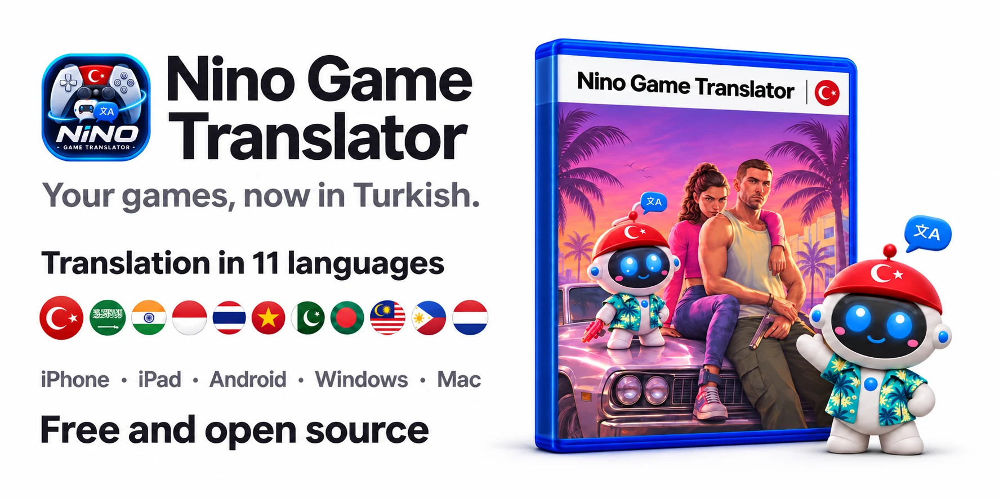
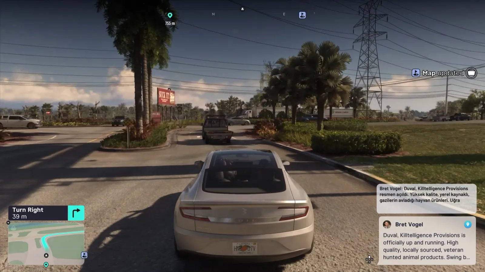
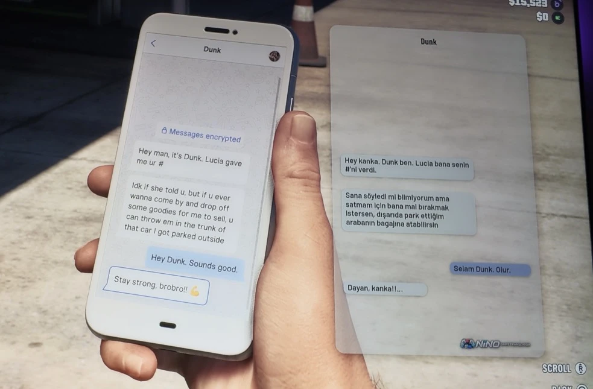
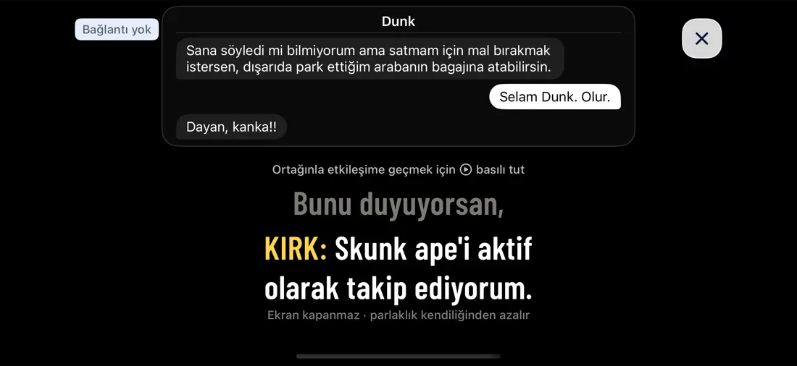
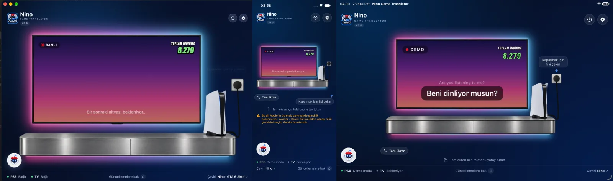

<p align="center">
  
</p>

<h1 align="center">Nino Game Translator</h1>

<p align="center"><b>The game speaks English. Your subtitles don't have to. Right on your TV, on top of the game.</b></p>

<p align="center">
  <a href="README.md">Türkçe</a> · <a href="README.ar.md">العربية</a> · <b>English</b>
</p>

<p align="center">Free · No ads · No account · Open source</p>

---

## What is Nino Game Translator?

It turns the English text in your games into **Turkish** or **Arabic**.

- Subtitles, phone messages, missions and the map: all translated.
- The translation shows **on your TV, on top of the game**.
- Works with **PS5** and **Xbox**. Free.

## What it looks like

<p align="center">
  
  <br><sub>A message arrives in the game, and its translation sits right above it.</sub>
</p>

<p align="center">
  
  <br><sub><b>Phone messages</b><br>Next to the in-game phone, one bubble at a time.</sub>
</p>

<p align="center">
  
  <br><sub><b>Map cards</b><br>Your current mission, translated at the top of the screen, so you know what to do at a glance.</sub>
</p>

<p align="center">
  
  <br><sub><b>iPhone, sideways</b><br>No TV? Turn your phone sideways: messages on top, subtitles in the middle.</sub>
</p>

<p align="center">
  
  <br><sub><b>Mac ↔ iPhone</b><br>The same Nino Game Translator, just as easy on every device.</sub>
</p>

<p align="center">
  
  <br><sub>From a real TV: Red Dead Redemption 2 · <a href="docs/img/rdr2-turkce-altyazi.mp4">▶️ Video with sound (30 s)</a></sub>
</p>

## Get started in 3 steps

1. **Download Nino Game Translator:** pick your device in the table below.
2. **Connect your console:** PS5 or Xbox, on the same Wi-Fi. For PS5 you need a free second PSN account. Nino Game Translator tells you what to do, step by step.
3. **Pick your TV:** Nino Game Translator installs the TV app for you.

Then start your game and, in Nino Game Translator, drag the plug into the socket: translation starts. That's it.

## Download

| Device | Download | How to install |
|---|---|---|
| Mac | [Nino-Mac.zip](https://github.com/yunusdemirbag/nino-game-translator/releases/latest/download/Nino-Mac.zip) | [Setup ↓](#setup-mac) |
| Windows | [Nino-Windows-Setup.exe](https://github.com/yunusdemirbag/nino-game-translator/releases/latest/download/Nino-Windows-Setup.exe) | [Setup ↓](#setup-windows) |
| iPhone and iPad | [TestFlight (Apple's free beta app)](https://testflight.apple.com/join/1K3Q1KXp) | [Setup ↓](#setup-iphone) |
| Android phone | [Nino-Telefon.apk (install file, not on Google Play yet)](https://github.com/yunusdemirbag/nino-game-translator/releases/latest/download/Nino-Telefon.apk) | [Setup ↓](#setup-android) |
| TV (Android TV, LG, Samsung) | Nino Game Translator installs it | [Setup ↓](#setup-tv) |
| Linux (advanced) | With Docker | [Setup ↓](#setup-linux) |

All files: [Nino Game Translator release page](https://github.com/yunusdemirbag/nino-game-translator/releases/latest)

## Setup

<a id="setup-mac"></a>
### Mac
1. Download **Nino-Mac.zip** and double-click it.
2. Drag **Nino** into **Applications** and open it.
3. If macOS says it can't be opened: **System Settings › Privacy & Security › Open Anyway**.

<a id="setup-windows"></a>
### Windows
1. Download **Nino-Windows-Setup.exe** and double-click it.
2. If you see "Windows protected your PC": **More info › Run anyway**.
3. Nino Game Translator opens by itself.

<a id="setup-iphone"></a>
### iPhone and iPad
1. Install **TestFlight** from the App Store.
2. Tap [this link](https://testflight.apple.com/join/1K3Q1KXp), then **Accept › Install**.
3. Open Nino Game Translator. (App Store version coming soon.)

<a id="setup-android"></a>
### Android phone
1. Download **Nino-Telefon.apk** on your phone and open it.
2. If your phone blocks apps from unknown sources, turn on **Allow from this source** in Settings, then come back.
3. Tap **Install**, then open Nino Game Translator.

<a id="setup-tv"></a>
### TV
Nothing to download: pick your TV in Nino Game Translator and it installs the app on the TV for you.
To install by hand: [Android TV](https://github.com/yunusdemirbag/nino-game-translator/releases/latest/download/Nino-TV.apk) · [LG](https://github.com/yunusdemirbag/nino-game-translator/releases/latest/download/Nino-TV.ipk) · [Samsung](https://github.com/yunusdemirbag/nino-game-translator/releases/latest/download/Nino-TV.wgt)

<a id="setup-linux"></a>
### Linux
The Linux version runs with Docker (Docker must be installed). Paste these two lines into a terminal:
```bash
curl -fsSLO https://raw.githubusercontent.com/yunusdemirbag/nino-game-translator/main/apps/linux/docker-compose.yml
docker compose up -d
```
Then open `http://localhost:8788` in a browser. From another device, use the computer's IP address instead (for example `http://192.168.1.20:8788`).

## Which TVs work?

✅ **Android TV / Google TV**, **Samsung**, **LG**, or a computer screen.

❌ Hisense (Vidaa), new Philips (Titan OS), TiVo and older non-Android TVs.
With these TVs, show the subtitles on your computer screen (Mac or Windows) instead, or turn your phone sideways to see them on the phone.

## Questions

**Does it cost money?** No. Completely free, no ads.

**Why a second PSN account?** Nino Game Translator connects to your PS5 with its own account, because the account you're playing on can't be used twice at once. A free account works fine.

**Nothing shows on the TV?** Make sure your console, your TV and the device running Nino Game Translator are on the same Wi-Fi, then restart Nino Game Translator.

**Which games?** Almost any game with English text. GTA 6 has special support.

More: [FAQ](docs/SSS.en.md) · Ask a question: [Issues page](https://github.com/yunusdemirbag/nino-game-translator/issues)

## Privacy

No Nino Game Translator account needed. Your game video isn't uploaded or saved anywhere. [Privacy policy](PRIVACY.md)

## Who makes it?

- **Yunus Demirbağ**: designs and builds Nino Game Translator.
- **M. Akif Demirbağ**: supports, tests and shares ideas.

Nino Game Translator is open source ([AGPL-3.0](LICENSE)); anyone can read the code.
Found a bug or have an idea? Tell us on the [Issues page](https://github.com/yunusdemirbag/nino-game-translator/issues). We read everything.
If you like Nino Game Translator, giving it a ⭐ (top right of this page) helps a lot.

---

<sub>Nino Game Translator is not affiliated with Sony, Microsoft, LG or Samsung. PlayStation, PS5, Xbox, LG and Samsung are trademarks of their owners. Game images belong to their owners.</sub>

<p align="center">Many thanks to <b>CouchSubs</b> and its developer <b>Sinan Yorulmaz</b>, who inspired our first versions.</p>

