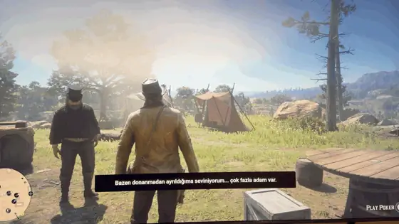

  

<h1 align="center">Nino Game Translator</h1>

<b>The game speaks English. Your subtitles don't have to. Right on your TV, on top of the game.</b>

  <a href="README.md">Türkçe</a> · <a href="README.ar.md">العربية</a> · <b>English</b>

Free · No ads · No account · Open source

---

## What is Nino?

Nino translates the English text in PS5 and Xbox games into Turkish or Arabic, instantly.
It translates subtitles, in-game phone messages, and mission and map cards.
The translation shows up on your TV, on top of the game. You just play as usual.

## What it looks like

  
   A message arrives in the game, and its translation sits right above it.

  
   From a real TV: Red Dead Redemption 2 · <a href="docs/img/rdr2-turkce-altyazi.mp4">▶️ Video with sound (30 s)</a>

<table>
  <tr>
    <td width="50%" align="center">
       
      <b>Phone messages</b> Next to the in-game phone, one bubble at a time.
    </td>
    <td width="50%" align="center">
       
      <b>Map cards</b> The mission card on top, so you know what to do at a glance.
    </td>
  </tr>
  <tr>
    <td width="50%" align="center">
       
      <b>iPhone, sideways</b> No TV? Turn your phone sideways: messages on top, subtitles in the middle.
    </td>
    <td width="50%" align="center">
       
      <b>Mac ↔ iPhone</b> The same Nino, just as easy on every device.
    </td>
  </tr>
</table>

## Get started in 3 steps

1. **Pick your device:** download Nino for Mac, Windows, iPhone, Android or Linux.
2. **Connect your PS5:** follow Nino's steps and type the 8-digit code your PS5 shows.
3. **Pick your TV:** LG, Samsung or Android TV. Nino installs the TV app for you.

Then start the game and plug in the plug in Nino. That's it.

## Download

| Device | Link |
|---|---|
| Mac (macOS 14+) | [Nino-Mac.zip](https://github.com/yunusdemirbag/nino-game-translator/releases/latest/download/Nino-Mac.zip) |
| Android phone and tablet | [Nino-Telefon.apk](https://github.com/yunusdemirbag/nino-game-translator/releases/latest/download/Nino-Telefon.apk) |
| iPhone and iPad | [Join on TestFlight](https://testflight.apple.com/join/1K3Q1KXp) · App Store review pending |
| Android TV / Google TV | [Nino-TV.apk](https://github.com/yunusdemirbag/nino-game-translator/releases/latest/download/Nino-TV.apk) · Nino can also install it for you |
| LG TV | [Nino-TV.ipk](https://github.com/yunusdemirbag/nino-game-translator/releases/latest/download/Nino-TV.ipk) · Nino installs it for you |
| Samsung TV | [Nino-TV.wgt](https://github.com/yunusdemirbag/nino-game-translator/releases/latest/download/Nino-TV.wgt) · Nino installs it for you |
| Windows | [Nino-Windows-Setup.exe](https://github.com/yunusdemirbag/nino-game-translator/releases/latest/download/Nino-Windows-Setup.exe) · 4.0.6 for now, 4.5 on the way |
| Linux | 4.5 coming soon |

If macOS warns on first launch: System Settings › Privacy & Security › **Open Anyway**. All files and install notes: [Nino 4.5 release page](https://github.com/yunusdemirbag/nino-game-translator/releases/latest).

## Which TVs work?

**Works on**
- Android TV and Google TV (including Android TV boxes)
- Samsung (Tizen)
- LG (webOS)
- A Mac or PC screen
- Any monitor (with an HDMI capture card or the computer screen)

**Does not work on**
- Vidaa (most Hisense TVs)
- TiVo
- Titan OS (newer Philips TVs)
- Axen
- Older Vestel TVs without Android
- TV boxes without Android

These TVs can't install other apps. The fix: plug an Android TV box into the TV, or show the subtitles on a computer screen.

## Questions people ask most

**Does it cost anything?**\
No. Nino is completely free. No ads, no subscription.

**Why do I need a second PSN account?**\
The PS5 won't allow remote play on the account you're playing with at the same time. A free second account is enough.

**Subtitles don't show on the TV. What now?**\
Make sure the console, Nino and the TV are on the same Wi-Fi. Then close Nino and the TV app and open them again.

**Which games does it work with?**\
Almost any game with English text on screen. GTA 6 has extra translation support.

**Does it work with Xbox?**\
Yes, in early testing. Your own Microsoft account is enough.

More answers: [FAQ](docs/SSS.en.md)

## Privacy

- You don't need an account.
- Your translation service key (API key) stays on your device. It is never sent to our server.
- The game picture is never saved or sent anywhere.

Details: [Privacy policy](PRIVACY.md)

## License and contact

Nino is open source under [AGPL-3.0](LICENSE). Build notes for developers: [docs/yeni](docs/yeni).
Questions and ideas: [GitHub › Issues](https://github.com/yunusdemirbag/nino-game-translator/issues)

Made by **Yunus Demirbağ** · Supported by **M. Akif Demirbağ**

Many thanks to **CouchSubs** and its developer **Sinan Yorulmaz**, who inspired our first versions.

Nino is not affiliated with Sony, Microsoft, LG or Samsung. PlayStation, PS5, Xbox, LG and Samsung are trademarks of their owners. Game images belong to their owners.
