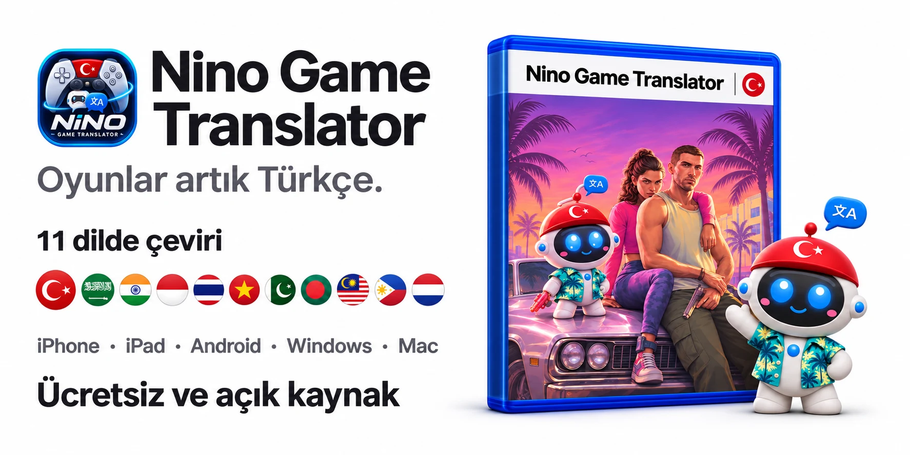

<p align="center">
  
</p>

<h1 align="center">Nino Game Translator</h1>

<p align="center"><b>Oyun İngilizce, altyazı Türkçe. TV'nde, oyunun tam üstünde.</b></p>

<p align="center">
  <b>Türkçe</b> · <a href="README.ar.md">العربية</a> · <a href="README.en.md">English</a>
</p>

<p align="center">Ücretsiz · Reklamsız · Hesap yok · Açık kaynak</p>

---

## Nino Game Translator nedir?

Oyunlardaki İngilizce yazıları **Türkçe** yapar.

- Altyazılar, telefon mesajları, görevler ve harita: hepsi Türkçe.
- Çeviri **TV'nde, oyunun üstünde** çıkar.
- **PS5** ve **Xbox** ile çalışır. Ücretsiz.

## Nasıl görünüyor?

<p align="center">
  
  <br><sub>Oyunda gelen mesaj, hemen üstünde Türkçesi.</sub>
</p>

<p align="center">
  
  <br><sub><b>Telefon mesajları</b><br>Oyundaki telefonun yanında, balon balon Türkçe.</sub>
</p>

<p align="center">
  
  <br><sub><b>Harita kartı</b><br>Görev kartı üstte Türkçe; ne yapacağını tek bakışta gör.</sub>
</p>

<p align="center">
  
  <br><sub><b>iPhone yatay ekran</b><br>TV yoksa telefonu yan çevir: mesajlar üstte, altyazı ortada.</sub>
</p>

<p align="center">
  
  <br><sub><b>Mac ↔ iPhone</b><br>Aynı Nino Game Translator, her cihazda aynı kolaylık.</sub>
</p>

<p align="center">
  
  <br><sub>Gerçek bir TV'den: Red Dead Redemption 2 · <a href="docs/img/rdr2-turkce-altyazi.mp4">▶️ Sesli video (30 sn)</a></sub>
</p>

## 3 adımda başla

1. **Nino Game Translator'ı indir:** Aşağıdaki tablodan cihazını seç.
2. **Konsolunu bağla:** PS5 ya da Xbox. Nino Game Translator ne yapacağını adım adım söyler.
3. **TV'ni seç:** TV uygulamasını Nino Game Translator kendisi kurar.

Sonra oyunu aç, Nino Game Translator'daki fişi tak. Hepsi bu.

## İndir

| Cihaz | İndir | Nasıl kurulur? |
|---|---|---|
| Mac | [Nino-Mac.zip](https://github.com/yunusdemirbag/nino-game-translator/releases/latest/download/Nino-Mac.zip) | [Kurulum ↓](#kurulum-mac) |
| Windows | [Nino-Windows-Setup.exe](https://github.com/yunusdemirbag/nino-game-translator/releases/latest/download/Nino-Windows-Setup.exe) | [Kurulum ↓](#kurulum-windows) |
| iPhone ve iPad | [TestFlight](https://testflight.apple.com/join/1K3Q1KXp) | [Kurulum ↓](#kurulum-iphone) |
| Android telefon | [Nino-Telefon.apk](https://github.com/yunusdemirbag/nino-game-translator/releases/latest/download/Nino-Telefon.apk) | [Kurulum ↓](#kurulum-android) |
| TV (Android TV, LG, Samsung) | Nino Game Translator kendisi kurar | [Kurulum ↓](#kurulum-tv) |
| Linux | Docker | [Kurulum ↓](#kurulum-linux) |

## Kurulum

<a id="kurulum-mac"></a>
### Mac
1. **Nino-Mac.zip**'i indir, çift tıkla.
2. Çıkan **Nino**'yu **Uygulamalar** klasörüne sürükle ve aç.
3. "Açılamıyor" derse: **Sistem Ayarları › Gizlilik ve Güvenlik › Yine de Aç**.

<a id="kurulum-windows"></a>
### Windows
1. **Nino-Windows-Setup.exe**'yi indir, çift tıkla.
2. "Windows bilgisayarınızı korudu" derse: **Ek bilgi › Yine de çalıştır**.
3. Nino Game Translator kendiliğinden açılır.

<a id="kurulum-iphone"></a>
### iPhone ve iPad
1. App Store'dan **TestFlight**'ı yükle.
2. [Bu linke](https://testflight.apple.com/join/1K3Q1KXp) dokun, **Kabul Et › Yükle**.
3. Nino Game Translator'ı aç. (App Store sürümü yakında.)

<a id="kurulum-android"></a>
### Android telefon
1. Telefonda **Nino-Telefon.apk**'yı indir ve aç.
2. "Bilinmeyen uygulamalar" izni sorarsa **İzin ver**.
3. **Yükle**'ye dokun, Nino Game Translator'ı aç.

<a id="kurulum-tv"></a>
### TV
Bir şey indirmene gerek yok: Nino Game Translator'da TV'ni seç, uygulamayı Nino Game Translator TV'ye kendisi kurar.
Elle kurmak istersen dosyalar: [Android TV](https://github.com/yunusdemirbag/nino-game-translator/releases/latest/download/Nino-TV.apk) · [LG](https://github.com/yunusdemirbag/nino-game-translator/releases/latest/download/Nino-TV.ipk) · [Samsung](https://github.com/yunusdemirbag/nino-game-translator/releases/latest/download/Nino-TV.wgt)

<a id="kurulum-linux"></a>
### Linux
```bash
curl -fsSLO https://raw.githubusercontent.com/yunusdemirbag/nino-game-translator/main/apps/linux/docker-compose.yml
docker compose up -d
```
Sonra tarayıcıda `http://<bilgisayarın adresi>:8788` aç.

Bütün dosyalar: [Nino Game Translator sürüm sayfası](https://github.com/yunusdemirbag/nino-game-translator/releases/latest)

## Hangi TV'lerde çalışır?

✅ **Android TV / Google TV**, **Samsung**, **LG**, ya da bilgisayar ekranı.

❌ Hisense (Vidaa), yeni Philips (Titan OS), TiVo ve Android olmayan eski TV'ler.
Bu TV'lerde altyazıyı Mac ya da bilgisayar ekranında görebilirsin. TV yoksa telefonu yan çevir: altyazı telefonda çıkar.

## Sık sorulanlar

**Ücretli mi?** Hayır. Tamamen ücretsiz, reklam yok.

**İkinci PSN hesabı neden lazım?** PS5, oynadığın hesapla aynı anda bağlantıya izin vermiyor. Ücretsiz ikinci hesap yeter.

**TV'de yazı çıkmıyor?** Konsol, Nino Game Translator ve TV aynı Wi-Fi'da olsun. Nino Game Translator'ı kapatıp aç.

**Hangi oyunlar?** İngilizce yazısı olan neredeyse her oyun. GTA 6'ya özel destek var.

Daha fazlası: [Sık Sorulan Sorular](docs/SSS.md) · Soru sor: [Issues](https://github.com/yunusdemirbag/nino-game-translator/issues)

## Gizlilik

Hesap açmazsın. Oyun görüntün hiçbir yere gitmez. [Gizlilik politikası](PRIVACY.md)

## Kimler yapıyor?

- **Yunus Demirbağ**: Nino Game Translator'ı tasarlayan ve geliştiren.
- **M. Akif Demirbağ**: destekleyen, deneyen, fikir veren.

Nino Game Translator açık kaynaktır ([AGPL-3.0](LICENSE)); kodu herkes görebilir.
Hata bulursan ya da bir fikrin varsa [Issues](https://github.com/yunusdemirbag/nino-game-translator/issues) sayfasına yaz, okuyoruz.
Nino Game Translator'ı beğendiysen sağ üstteki ⭐ ile destek olabilirsin.

---

<sub>Nino Game Translator; Sony, Microsoft, LG ve Samsung ile bağlantılı değildir. PlayStation, PS5, Xbox, LG ve Samsung sahiplerinin markalarıdır. Görsellerdeki oyun görüntüleri sahiplerine aittir.</sub>

<p align="center">İlk sürümlerimize ilham veren <b>CouchSubs</b> ve geliştiricisi <b>Sinan Yorulmaz</b>'a çok teşekkür ederiz.</p>

