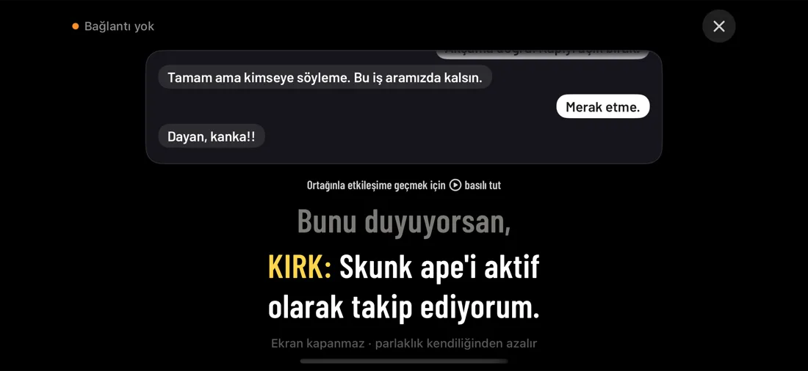

  

<h1 align="center">Nino Game Translator</h1>

<b>Oyun İngilizce, altyazı Türkçe. TV'nde, oyunun tam üstünde.</b>

  <b>Türkçe</b> · <a href="README.ar.md">العربية</a> · <a href="README.en.md">English</a>

Ücretsiz · Reklamsız · Hesap yok · Açık kaynak

---

## Nino nedir?

Nino, PS5 ve Xbox oyunlarındaki İngilizce yazıları anında Türkçeye ya da Arapçaya çevirir.
Altyazıları, oyundaki telefon mesajlarını, görev ve harita kartlarını çevirir.
Çeviri TV'de, oyunun üstünde görünür. Sen her zamanki gibi oynarsın.

## Nasıl görünüyor?

  
   Oyunda gelen mesaj, hemen üstünde Türkçesi.

<table>
  <tr>
    <td width="50%" align="center">
       
      <b>Telefon mesajları</b> Oyundaki telefonun yanında, balon balon Türkçe.
    </td>
    <td width="50%" align="center">
       
      <b>Harita kartı</b> Görev kartı üstte Türkçe; ne yapacağını tek bakışta gör.
    </td>
  </tr>
  <tr>
    <td width="50%" align="center">
       
      <b>iPhone yatay ekran</b> TV yoksa telefonu yan çevir: mesajlar üstte, altyazı ortada.
    </td>
    <td width="50%" align="center">
       
      <b>Mac ↔ iPhone</b> Aynı Nino, her cihazda aynı kolaylık.
    </td>
  </tr>
</table>

## 3 adımda başla

1. **Cihazını seç:** Mac, Windows, iPhone, Android ya da Linux'a Nino'yu indir.
2. **PS5'i bağla:** Nino'nun söylediklerini yap, PS5'teki 8 haneli kodu yaz.
3. **TV'ni seç:** LG, Samsung ya da Android TV. TV uygulamasını Nino kendisi kurar.

Sonra oyunu aç, Nino'daki fişi tak. Hepsi bu.

## İndir

| Cihaz | Bağlantı |
|---|---|
| Mac | yayın günü eklenecek |
| Windows | yayın günü eklenecek |
| iPhone ve iPad | yayın günü eklenecek |
| Android telefon | yayın günü eklenecek |
| Linux | yayın günü eklenecek |
| Android TV | yayın günü eklenecek |

## Hangi TV'lerde çalışır?

**Çalışır**
- Android TV ve Google TV (Android TV kutuları dahil)
- Samsung (Tizen)
- LG (webOS)
- Mac ya da bilgisayar ekranı
- Monitör (HDMI kartla ya da bilgisayar ekranıyla)

**Çalışmaz**
- Vidaa (çoğu Hisense)
- TiVo
- Titan OS (yeni Philips'ler)
- Axen
- Android olmayan eski Vestel'ler
- Android olmayan TV kutuları

Bu TV'lere başka uygulama kurulamıyor. Çözüm: TV'ye bir Android TV kutusu tak ya da altyazıyı bilgisayar ekranında gör.

## Sık sorulanlar

**Para ödemem gerekir mi?**\
Hayır. Nino tamamen ücretsiz. Reklam ve abonelik yok.

**İkinci bir PSN hesabı neden gerekiyor?**\
PS5, oynadığın hesapla aynı anda uzaktan bağlantıya izin vermiyor. Ücretsiz ikinci bir hesap yeter.

**TV'de altyazı çıkmıyor, ne yapayım?**\
Konsol, Nino ve TV aynı Wi-Fi'da olsun. Nino'yu ve TV uygulamasını kapatıp yeniden aç.

**Hangi oyunlarda çalışır?**\
Ekranda İngilizce yazı olan neredeyse her oyunda. GTA 6 için özel çeviri desteği var.

**Xbox'ta da çalışır mı?**\
Evet, deneme aşamasında. Kendi Microsoft hesabın yeter.

Daha fazlası: [Sık Sorulan Sorular](docs/SSS.md)

## Gizlilik

- Hesap açman gerekmez.
- Çeviri hizmeti anahtarın (API anahtarı) yalnız senin cihazında kalır, sunucumuza gitmez.
- Oyun görüntüsü kaydedilmez, hiçbir yere gönderilmez.

Ayrıntılar: [Gizlilik politikası](PRIVACY.md)

## Lisans ve iletişim

Nino açık kaynaktır, [AGPL-3.0](LICENSE) lisanslıdır. Kaynak koddan derlemek isteyenler için: [docs/yeni](docs/yeni).
Soru ve öneri için: [GitHub › Issues](https://github.com/yunusdemirbag/nino-game-translator/issues)

Geliştiren: **Yunus Demirbağ** · Destekleyen: **M. Akif Demirbağ**

Nino; Sony, Microsoft, LG ve Samsung ile bağlantılı değildir. PlayStation, PS5, Xbox, LG ve Samsung sahiplerinin markalarıdır. Görsellerdeki oyun görüntüleri sahiplerine aittir.
