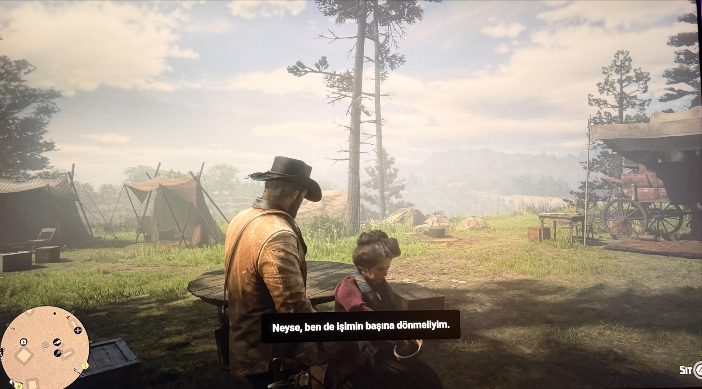
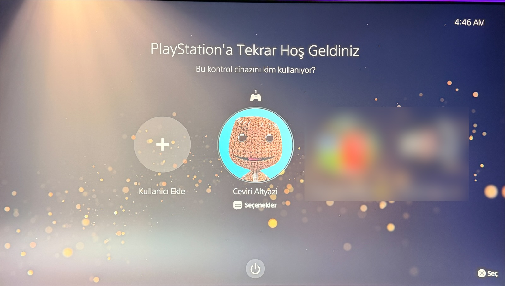
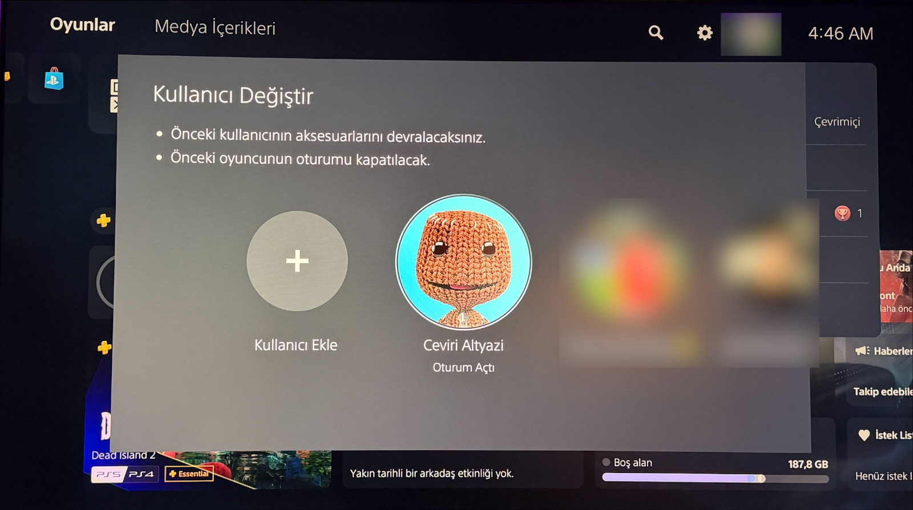
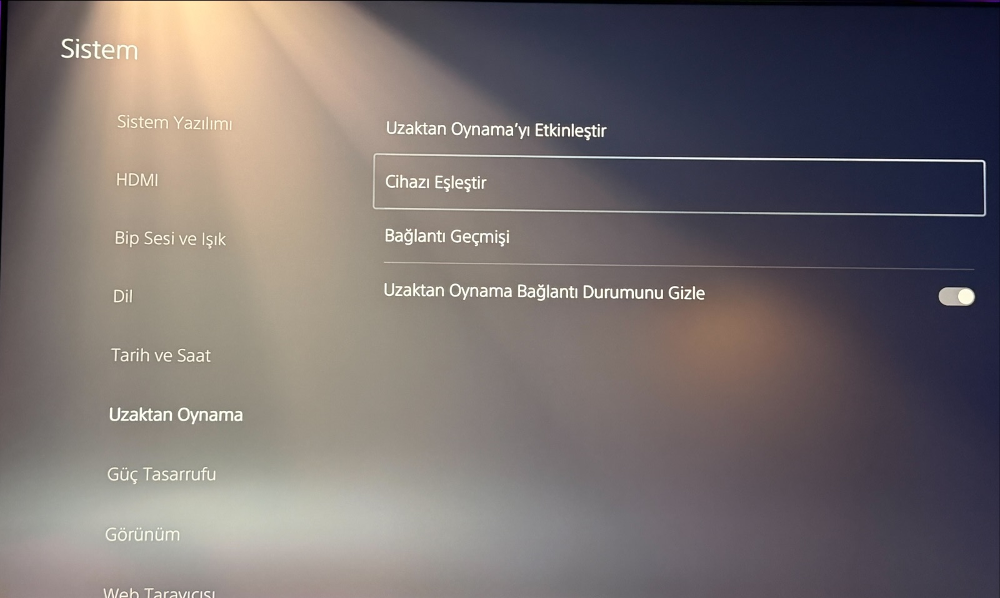
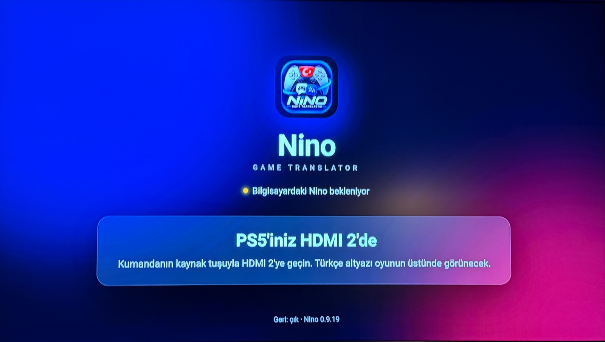
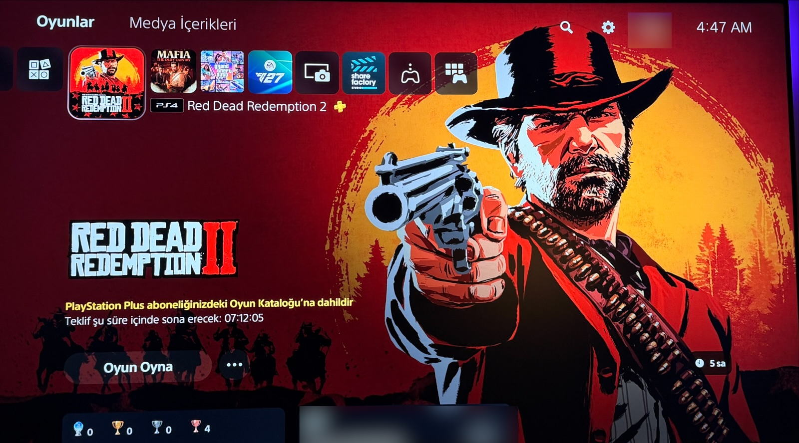
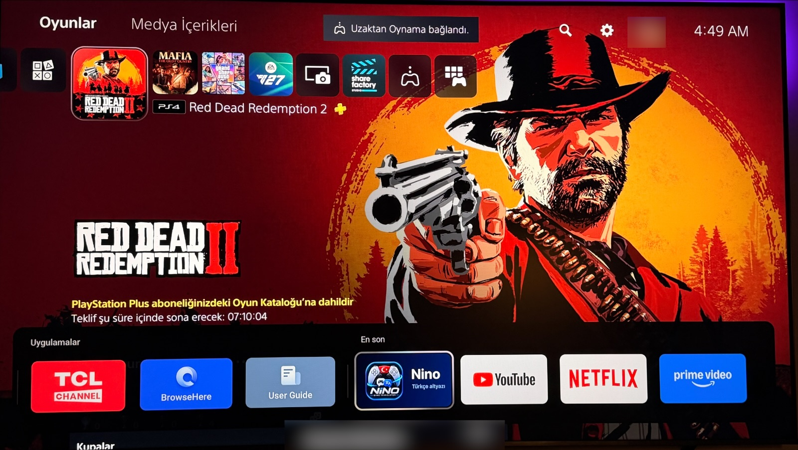
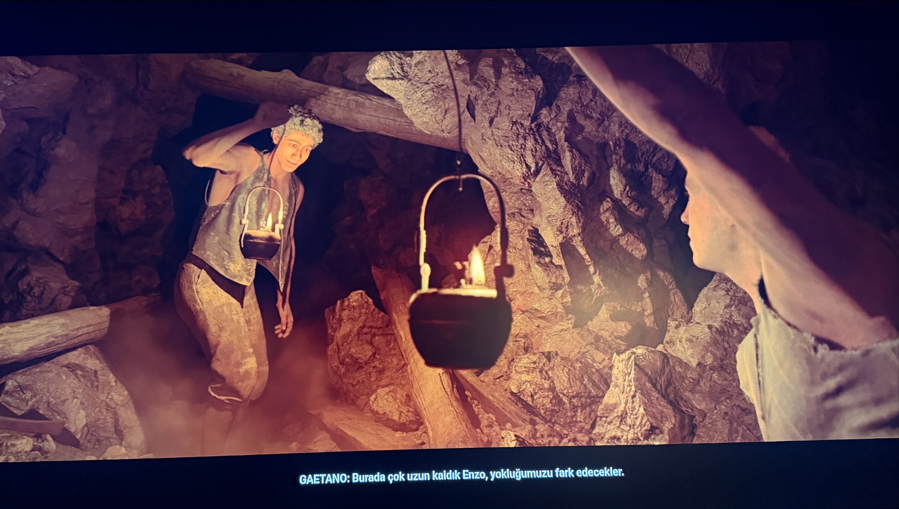

# Fotoğraflı Kurulum: PS5 + Android TV

Bu rehber, PS5'i **Android TV ya da Google TV**'ye bağlı olanlar içindir (TCL, iFFALCON, Sony, Philips, Vestel, Arçelik,
Beko, Grundig ve diğerleri). Bilgisayar olarak Mac ya da Windows kullanılır. Fotoğraflar gerçek bir kurulumdan alınmıştır;
menü adları PS5'in Türkçe arayüzündeki gibidir.

*Sonuç: oyun TV'de, Türkçe altyazı oyunun üstünde (Red Dead Redemption 2).*

Kurulum bir kez yapılır ve yaklaşık **10 dakika** sürer. PS5, TV ve bilgisayar **aynı Wi-Fi ağında** olmalıdır.

> Genel rehber (telefon, Capture Card, Xbox): **[📘 Kurulum Rehberi](KURULUM.md)**

---

## Nasıl çalışır?

Siz oyunu her zamanki gibi TV'de, kendi hesabınızla ve kendi kolunuzla oynarsınız. Bilgisayardaki Nino, oyunu **ikinci
bir PSN hesabıyla** Uzaktan Oynama üzerinden izler, İngilizce altyazıyı okur ve Türkçesini TV'deki **Nino uygulamasına**
gönderir. Çeviri, oyunun üstünde görünür.

İkinci hesap şart: Nino sizin hesabınızla bağlansaydı PS5 kolunuzu kapatırdı. İkinci hesap ücretsizdir ve oyunun
kendisine hiçbir şekilde dokunmaz.

---

## Adım 1 — İkinci PSN hesabını PS5'e ekleyin

1. [playstation.com](https://www.playstation.com)'da **yeni bir e-posta adresiyle** ücretsiz bir PSN hesabı oluşturun.
2. PS5'te kullanıcı seçme ekranında **Kullanıcı Ekle**'yi seçin ve yeni hesapla bir kez giriş yapın.

Aşağıdaki örnekte ikinci hesabın adı **"Ceviri Altyazi"**dir. Siz istediğiniz adı verebilirsiniz.

> PS5 açıkken başka bir hesaba geçmek için: **PS düğmesi › profil resminiz › Kullanıcı Değiştir**.
>
> 

---

## Adım 2 — İkinci hesapta Uzaktan Oynama'yı açın

İkinci hesaptayken **Ayarlar › Sistem › Uzaktan Oynama**'ya gidin:

| Seçenek | Ne yapılacak |
|---|---|
| **Uzaktan Oynama'yı Etkinleştir** | Açın. |
| **Uzaktan Oynama Bağlantı Durumunu Gizle** (en alttaki) | **Açın.** Böylece oyun sırasında "Uzaktan Oynama bağlandı" bildirimi çıkmaz. |
| **Cihazı Eşleştir** | Adım 3'te bilgisayardaki Nino isteyince seçeceksiniz. |

---

## Adım 3 — Bilgisayarda Nino'yu kurun

1. Nino'yu indirip açın: [Mac](https://github.com/yunusdemirbag/nino-game-translator/releases/latest/download/Nino-Mac.zip)
   · [Windows](KURULUM.md#2-mac-ve-windows-ile-kurulum-tv-için-önerilen).
2. İlk ekranda **PS5**'i seçin ve **Devam**'a basın.
3. **İkinci hesabınızla giriş yapın.** Şifrenizi yalnızca Sony'nin kendi sayfasına yazarsınız; Nino şifrenizi görmez.
4. **PS5'inizi bağlayın.** PS5'te ikinci hesaptayken **Ayarlar › Sistem › Uzaktan Oynama › Cihazı Eşleştir**'i seçin.
   TV'de görünen **8 haneli kodu** Nino'ya yazın ve **Bağlan**'a basın. Kod yaklaşık 5 dakika geçerlidir.
5. **TV'nizi bağlayın.** **Android TV / Google TV**'yi seçin. Nino, TV uygulamasını TV'ye kendisi kurar ve açar.
   Bunun için TV'de bir kez **USB hata ayıklama** açık olmalı ([nasıl açılır?](KURULUM.md#5-tv-uygulamasını-kurma)).
   TV izin isterse kumandayla **İzin ver**'e basın.

---

## Adım 4 — TV'de Nino uygulaması

Kurulumdan sonra Nino, TV'nin uygulamalar satırında görünür. Açtığınızda bilgisayardaki Nino'yu bekler ve PS5'in hangi
HDMI girişinde olduğunu söyler.

---

## Adım 5 — Oynayın

1. PS5'te **kendi hesabınıza** dönün ve oyununuzu açın.

   

2. Bilgisayardaki Nino uygulamasının ekranındaki **çizilmiş fişi prize takın** (tıklayın ya da sürükleyin). PS5'in ya da TV'nin gerçek kablosuna dokunmayın. Nino ikinci hesapla bağlanır; TV'deki
   Nino uygulaması kendiliğinden açılır.

   

3. TV kumandasının kaynak tuşuyla PS5'in HDMI girişine geçin. Türkçe altyazı, oyunun üstünde görünür.

   

   Konuşanın adı da çevrilir ve altyazı oyunun kendi yerinde durur (Mafia: The Old Country):

   

Bir dahaki sefere yalnız 5. adım yeterlidir: oyunu açın, Nino ekranındaki fişe tıklayın.

---

## Sorun giderme

| Sorun | Çözüm |
|---|---|
| TV'de **"Bilgisayardaki Nino bekleniyor"** yazısı gitmiyor | Bilgisayardaki Nino'nun açık olduğundan ve uygulamadaki fişin takılı (çevirinin açık) olduğundan emin olun. Olmazsa bilgisayardaki Nino'yu kapatıp yeniden açın. TV ve bilgisayar aynı Wi-Fi'da olmalı. |
| Bilgisayarda **"TV uygulaması bekleniyor"** yazıyor | TV'de Nino uygulamasını açın. Bilgisayarda Nino'nun yalnızca **bir** kopyasının açık olduğundan emin olun. |
| Oyun açılırken yasal uyarılar ya da menü yazıları çevriliyor | Nino yalnız oyunun altyazı alanını okur; açılış ekranları geçince düzelir. Ayarlar › Altyazı alanı'ndan alanı daraltabilirsiniz. |
| Ekranda **"Uzaktan Oynama bağlandı"** bildirimi çıkıyor | İkinci hesapla Ayarlar › Sistem › Uzaktan Oynama'da **Uzaktan Oynama Bağlantı Durumunu Gizle**'yi açın. |
| PS5 bulunamıyor | PS5 açık ya da dinlenme modunda olmalı ve aynı Wi-Fi'da olmalı. Mac'te **Sistem Ayarları › Gizlilik ve Güvenlik › Yerel Ağ**'da Nino'ya izin verin. Gerekirse PS5'in IP adresini elle girin. |
| TV'deki Nino eski mi? | TV'de Nino'yu açıp kumandada **OK**'e basın. Panelin en üstünde **V3.2** yazmıyorsa bilgisayardaki Nino'dan **TV'ye kur**'a yeniden basın. |
| Her şeyi baştan kurmak istiyorum | Nino'da **Ayarlar › Sıfırla**. |
