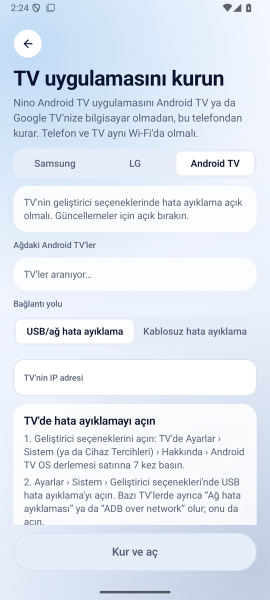
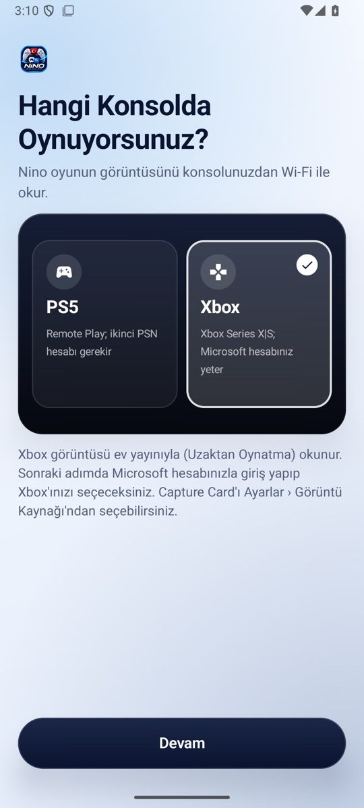
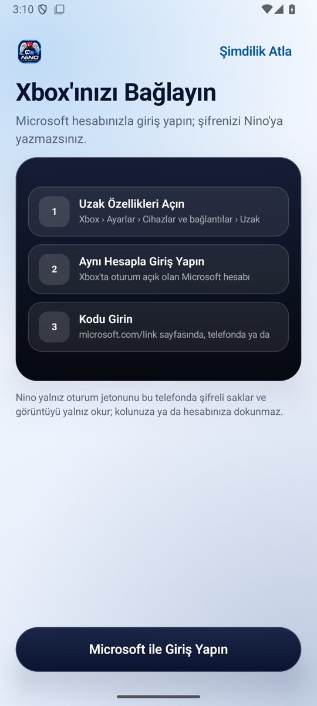
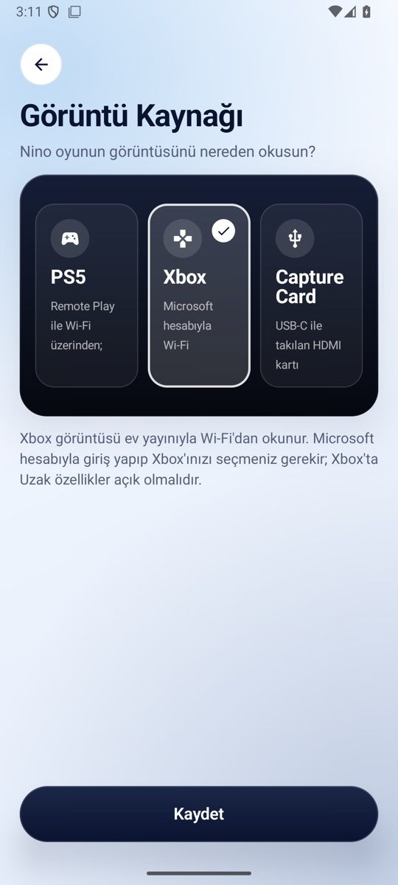
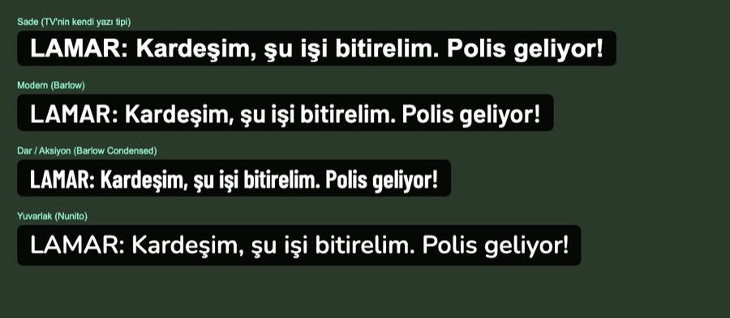

# Nino Kurulum Rehberi

Bu rehber, Nino'yu ilk kez kuracak herkes için. Teknik bilgi gerekmez. Adımları sırayla izleyin.
Kurulum yaklaşık **5–10 dakika** sürer.

> **Güncel sürüm: Nino V4.0** (4.0.0). Mac, Windows, Android telefon, iPhone ve TV uygulaması aynı sürümde.
> Telefonda ve bilgisayarda sürümü **Ayarlar › Hakkında**'da görürsünüz. TV'de: [TV uygulamam güncel mi?](#tv-uygulamam-güncel-mi)

> 🌍 **11 dil:** 🇹🇷 Türkçe · 🇸🇦 العربية · 🇮🇳 हिन्दी · 🇮🇩 Bahasa Indonesia · 🇹🇭 ไทย · 🇻🇳 Tiếng Việt · 🇵🇰 اردو · 🇧🇩 বাংলা ·
> 🇲🇾 Bahasa Melayu · 🇵🇭 Filipino · 🇳🇱 Nederlands. Karşılama ekranının sağ üstündeki bayraktan seçin; hem çeviri hem
> uygulamanın menüleri o dile geçer.

---

## 1. Önce hangi kurulumun size uygun olduğunu seçin

| Durumunuz | Önerilen kurulum | Neye ihtiyacınız var |
|---|---|---|
| PS5'iniz **akıllı TV'ye ya da akıllı monitöre** bağlı (Android TV / Google TV, Samsung, LG) | **Mac ya da Windows + TV** (önerilen) | Mac ya da Windows bilgisayar, TV'de Nino uygulaması, ikinci (ücretsiz) PSN hesabı |
| Bilgisayarınız yok ama TV'niz akıllı | **Telefon + TV** | Android telefon, TV'de Nino uygulaması, ikinci PSN hesabı |
| PS5'iniz **sıradan bir monitöre / eski TV'ye** bağlı | **Telefon ekranında altyazı** | Android telefon ya da iPhone, ikinci PSN hesabı |
| Elinizde **HDMI Capture Card** var | **Mac/Windows + Capture Card** | Mac ya da Windows bilgisayar, Capture Card (Remote Play ve ikinci hesap gerekmez) |
| **Yayın** yapıyorsunuz (OBS, TikTok LIVE Studio) | **Windows + Capture Card + OBS** (bkz. Bölüm 7) | Kart OBS'e bağlı kalır, Nino altyazıyı OBS projektöründen okur |
| **Xbox Series X\|S**'te oynuyorsunuz | **Android telefon** (ya da Mac/Windows'ta Xbox penceresi) | Microsoft hesabınız; ikinci hesap gerekmez (bkz. Bölüm 6) |
| Sadece **denemek** istiyorsunuz | **Demo** | Yalnız telefon: "PS5'siz Deneyin" |

Hepsinde konsol (PS5 ya da Xbox), telefon/bilgisayar ve TV **aynı Wi-Fi ağında** olmalıdır.

---

## 2. Mac ve Windows ile kurulum (TV için önerilen)

> 📷 PS5 ve Android TV için adım adım fotoğraflı anlatım: **[Android TV Rehberi](KURULUM-ANDROID-TV.md)**

**Mac**
1. **[Nino-Mac.zip](https://github.com/yunusdemirbag/nino-game-translator/releases/latest/download/Nino-Mac.zip)**
   dosyasını indirip açın.
2. **Nino**'yu **Uygulamalar** klasörüne sürükleyin.
3. Nino'yu açın. Mac "doğrulanamadı" derse: **Sistem Ayarları › Gizlilik ve Güvenlik › Yine de Aç**.
4. Nino sizi adım adım yönlendirir: ikinci PSN hesabıyla giriş → PS5'i 8 haneli kodla eşleme → TV seçimi.
5. TV seçiminde Nino, TV uygulamasını TV'ye kendisi kurar. Bunun için TV'de bir kez geliştirici modu açılır
   (bkz. [Bölüm 5](#5-tv-uygulamasını-kurma)).

**Windows**
1. **[Nino-Windows-Setup.exe](https://github.com/yunusdemirbag/nino-game-translator/releases/latest/download/Nino-Windows-Setup.exe)**
   dosyasını indirip çalıştırın.
2. "Bilgisayarınızı korudu" uyarısı çıkarsa: **Ek bilgi › Yine de çalıştır**.
3. Gerisi Mac ile aynıdır.

**Capture Card'ınız varsa:** İlk açılışta ya da **Ayarlar › Bağlantı**'da görüntü kaynağı olarak **Capture Card**'ı
seçin. Kartı PS5 ile TV/monitör arasına bağlayın. Bu yolda Remote Play ve ikinci PSN hesabı gerekmez.

Mac ve Windows'taki Nino yeni sürümleri kendiliğinden indirip kurar.

---

## 3. Android telefonla kurulum (bilgisayar yerine)

### 3.1 Uygulamayı yükleyin
1. Telefonda şu bağlantıyı açın:
   **[Nino-Telefon.apk](https://github.com/yunusdemirbag/nino-game-translator/releases/latest/download/Nino-Telefon.apk)**
2. İnen dosyaya dokunun. Telefon izin isterse **"Bu kaynaktan yüklemeye izin ver"** seçeneğini açın ve **Yükle**'ye basın.
3. Daha önce Nino kuruluysa yeni sürüm eskisinin üstüne kurulur. Ayarlarınız korunur.
4. Sürümü görmek için: Nino'da **Ayarlar › Hakkında**. Güncel sürüm **V4.0** (4.0.0).

### 3.2 İlk açılış
1. **Karşılama:** Üç kısa sayfa Nino'yu tanıtır. Sağ üstteki bayraktan çeviri dilini seçin (11 dil; Türkçe en üstte).
2. **Konsol:** "Hangi Konsolda Oynuyorsunuz?" ekranında **PS5**'i seçin. (Xbox için Bölüm 6'ya bakın.)
3. **Adım 1 – İkinci PSN Hesabı:** **"Sony İle Giriş Yapın"**a dokunun ve oyun oynadığınız hesaptan **farklı**,
   ücretsiz bir PlayStation hesabıyla giriş yapın. Giriş Sony'nin kendi sayfasında yapılır; şifreniz Nino'ya gelmez.
   *(Neden ikinci hesap? PS5, oyun oynadığınız hesapla aynı anda Remote Play bağlantısı açmaya izin vermez.)*
4. **Adım 2 – PS5'inizi Bağlayın:** Nino PS5'inizi ağda kendiliğinden bulur.
   - PS5'te **ikinci hesapla** giriş yapın → **Ayarlar › Sistem › Uzaktan Oynama › Cihazı Eşleştir**.
   - Ekranda çıkan **8 haneli kodu** telefona yazın ve **Bağlan**'a basın.
   - PS5 görünmüyorsa: PS5'in açık ya da dinlenme modunda olduğundan emin olun; liste birkaç saniyede bir yenilenir.
5. **Adım 3 – Altyazılar Nerede Görünsün?**
   - **TV'de:** Akıllı TV'nizde Nino uygulaması varsa. Yoksa bu ekrandaki **"TV uygulamasını kurun"**a dokunun; telefon
     kurar (bkz. Bölüm 5).
   - **Telefonda:** TV uygulaması yoksa ya da PS5 bir monitöre bağlıysa. Telefonu ekranın yanına koymanız yeterli.

### 3.3 Kullanım
1. PS5'te oyununuzu kendi hesabınızla açın.
2. Nino'nun ana ekranındaki **çizilmiş fişe dokunun ya da prize sürükleyin**. Bu, uygulamanın ekranındaki düğmedir; PS5'in ya da TV'nin gerçek fişine dokunmayın.
3. Altyazılar akmaya başlar. Telefonu **yan çevirirseniz** altyazı **tam ekran** açılır.
4. Durdurmak için ekrandaki fişi çekin.

> İpucu: Uzun oyunlarda telefonu şarja takın. Wi-Fi zayıfsa telefonu modeme yakın tutun.

---

## 4. iPhone ve iPad

iPhone uygulaması App Store incelemesinde. O zamana kadar **TestFlight** ile ücretsiz kurabilirsiniz:
1. App Store'dan Apple'ın **TestFlight** uygulamasını kurun.
2. Bu bağlantıyı iPhone'da açın: **[TestFlight ile Nino](https://testflight.apple.com/join/1K3Q1KXp)**.
3. **Yükle**'ye dokunun.

Kurulum adımları Android ile aynıdır (Bölüm 3.2).

> **Google Play:** Android uygulaması Google Play'de kapalı testte. Herkese açılınca bağlantısı burada olacak; o zamana
> kadar APK ile kurun (Bölüm 3).

---

## 5. TV uygulamasını kurma

Altyazının TV'de, oyunun üstünde görünmesi için TV'ye bir kez **Nino TV** uygulaması kurulur.

**Önerilen yol:** TV'de bir kez geliştirici modunu açın. Sonra telefondaki ya da bilgisayardaki Nino uygulamayı TV'ye
kendisi kurar ve **sonraki güncellemeleri de kendisi yapar**. TV, telefon/bilgisayar ve konsol **aynı Wi-Fi'da** olmalıdır.

| TV'niz | Ne yapılır |
|---|---|
| **Android TV / Google TV** (TCL, iFFALCON, Sony, Philips, Xiaomi, Hisense, Vestel, Arçelik…) | USB hata ayıklamayı açın (5.1) |
| **Samsung** TV ya da Samsung **akıllı monitör** (M serisi; 2016 ve sonrası) | Geliştirici modunu açın (5.1) |
| **LG** TV (webOS) — deneysel | Developer Mode uygulamasını açın (5.1) |

Takılırsanız uygulamadaki **Nino'ya Sor** yardımcısı TV'nizin markasını sorar ve geliştirici modunu adım adım anlatır.

### 5.1 Telefondan kurulum (bilgisayar gerekmez)

Android telefondaki Nino'da **Profil › Nino'yu TV'ye Kur**'a dokunun. (Ya da kurulumdaki "Altyazılar Nerede Görünsün?"
ekranında **TV uygulamasını kurun**.) Telefon ağdaki TV'leri arar. Markanızı seçin ve aşağıdaki adımları izleyin.

#### Android TV / Google TV
1. TV'de **Ayarlar › Sistem › Hakkında**'ya gidin. (Bazı TV'lerde: **Ayarlar › Cihaz Tercihleri › Hakkında**.)
2. **Android TV işletim sistemi yapısı** (ya da **Android TV OS derlemesi**) satırına art arda **7 kez** basın. "Artık geliştiricisiniz" yazar.
3. **Ayarlar › Sistem › Geliştirici seçenekleri**'ne girin.
4. **USB hata ayıklama**'yı açın. Varsa **Kablosuz hata ayıklama**'yı da açın.
5. Telefonda **Kur ve aç**'a basın.
6. TV'de "USB hata ayıklamasına izin verilsin mi?" sorusu çıkar. **Her zaman izin ver** kutusunu işaretleyin.
7. **İzin ver**'e basın. Nino TV'de açılır.

Hata ayıklamayı açık bırakın. Böylece TV uygulaması kendiliğinden güncellenir.

#### Samsung TV / akıllı monitör
1. TV'de **Uygulamalar** ekranını açın. 2022 ve sonrası modellerde sayfanın **en altına** inip **Uygulama Ayarları**'nı seçin; rakamlar ilk sayfada hiçbir şey yapmaz.
2. **1 2 3 4 5** yazın. Kumandada rakam tuşu yoksa **123** tuşuna basıp rakamları ekrandan seçin. Beşinci rakamdan sonra **Geliştirici modu** penceresi açılır.
3. **Developer mode**'u **On** yapın.
4. **Host PC IP** alanına telefonda (ya da bilgisayarda) gösterilen adresi yazın ve **OK**'i seçin. Her bölümü olduğu gibi yazın, başına sıfır koymayın (001 değil 1). Adres değiştirilemiyorsa önce **123** tuşuna basın.
5. TV'yi tam olarak yeniden başlatın: güç tuşunu **Samsung logosu görünene kadar** basılı tutun ya da TV'nin gerçek elektrik fişini bir dakikalığına çekin. (Kısa basmak yetmez; TV yalnızca bekleme moduna geçer.)
6. Telefonda **Kur ve aç**'a basın. İlk kurulumda bir kez **ücretsiz Samsung hesabıyla** giriş istenir.

Pencere açılmıyorsa: TV'yi tam yeniden başlatıp yeniden deneyin (bazı TV'lerde ikinci ya da üçüncü denemede açılır), TV'ye USB klavye takıp 12345 yazın ya da Mac'teki Nino'da **Pencere açılmıyor mu?** altındaki **TV'ye 1 2 3 4 5 yaz** düğmesini deneyin (yalnızca bazı TV'lerde çalışır).

Mac'teki Nino neyin eksik olduğunu kendisi gösterir: geliştirici modu açık mı, TV'deki Host PC IP bilgisayarın adresi mi, TV ayardan sonra yeniden başlatılmış mı. Eksik adım tamamlanınca kurulum kendiliğinden sürer.

#### LG TV (deneysel)
1. webostv.developer.lge.com'da ücretsiz **LG geliştirici hesabı** açın.
2. TV'de LG Content Store'dan **Developer Mode** uygulamasını kurun.
3. Uygulamada hesabınızla girin ve **Dev Mode Status**'u açın.
4. Uygulamayı yeniden açın ve **Key Server**'ı açın. Sol altta 6 karakterli **Passphrase** görünür.
5. Bu kodu telefona yazın ve **Kur ve aç**'a basın.
6. Geliştirici modu en çok 1000 saat açık kalır. Süre dolmadan Developer Mode uygulamasında **EXTEND**'e basın.

### 5.2 Bilgisayardan kurulum

Mac ya da Windows'taki Nino, kurulumun TV adımında TV'nizi bulur ve uygulamayı kendisi kurar. TV'de yapılacak ayar
5.1'deki ile aynıdır.

### TV uygulamam güncel mi?

1. TV'de Nino'yu açın.
2. Kumandada **OK**'e basın. Bir panel açılır.
3. Panelin en üstünde, başlığın yanında sürüm yazar. Güncel sürüm: **V4.0** (4.0.0).

**V4.0 yazmıyorsa** TV uygulamanız eski. Telefondaki ya da bilgisayardaki Nino'dan **TV'ye kur**'a yeniden basın.
Geliştirici modu açıksa Nino güncellemeyi kendisi yapar.

### 5.3 Son çare: TV'nin tarayıcısıyla elle kurulum (yalnız Android TV / Google TV)

Yukarıdaki yollar olmazsa:
1. TV'nin tarayıcısında en üstteki **adres (URL) çubuğuna** `https://is.gd/ninotvapk` yazın.
   (Tam adres: `https://yunusdemirbag.github.io/nino-game-translator/tv.apk`)
2. İnen dosyayı açıp kurun.
3. Bazı TV'lerde (ör. TCL) şu izni de açın: **Ayarlar › Uygulamalar › Özel uygulama erişimi › Diğer uygulamaların
   üzerinde göster › Nino**.

Bu yolla kurulan uygulama **kendiliğinden güncellenmez**. Güncellemek için USB hata ayıklamayı açıp Nino'da **TV'ye kur**'a
basın ya da bu adımları tekrarlayın.

TV'de Nino'yu açtığınızda TV, konsolun bağlı olduğu HDMI girişini gösterir ve altyazıyı oyunun üstüne yazar.

---

## 6. Xbox ile kullanım (yeni, deneysel)

> Xbox desteği 0.1.8'de geldi. Kod hazır ve testleri geçiyor ama gerçek bir Xbox ile henüz az denendi. Sorun görürseniz
> [GitHub › Issues](https://github.com/yunusdemirbag/nino-game-translator/issues)'a yazın.

  &nbsp;
  &nbsp;
  

### 6.1 Android telefonla (önerilen)
1. **Xbox'ta:** **Ayarlar › Cihazlar ve bağlantılar › Uzak özellikler**'i açın. Güç modu "Uyku" olmalı ki Nino Xbox'ı
   uzaktan bulabilsin.
2. **Telefonda:** Nino'yu açın, **"Hangi Konsolda Oynuyorsunuz?"** ekranında **Xbox**'ı seçin.
   (Daha önce kurduysanız: **Ayarlar › Görüntü Kaynağı › Xbox**.)
3. **Microsoft ile Giriş Yapın**'a dokunun. Nino bir kod gösterir; **Kodu Kopyala ve Sayfayı Aç** ile
   microsoft.com/link sayfasında kodu girin. Xbox'ta oturum açık olan **aynı hesabı** kullanın. Şifrenizi Nino'ya yazmazsınız.
4. Listeden Xbox'ınızı seçin. Oyunu açıp Nino ekranındaki **fişe dokunun**; altyazılar telefonda ya da TV'de akar.

PS5'tekinin aksine **ikinci hesap gerekmez**: Nino, Xbox uygulamasındaki "Uzaktan oynat" ile aynı ev yayınını yalnız
izler. Ses çalmaz, kolunuza ya da hesabınıza dokunmaz.

### 6.2 Mac ya da Windows ile (Xbox penceresi)
1. Xbox'ı bilgisayarda açın: **Windows**'ta Microsoft'un **Xbox** uygulamasındaki **Uzaktan oynat**, **Mac**'te ücretsiz
   [Greenlight](https://github.com/unknownskl/greenlight) ya da tarayıcıda **xbox.com/play**.
2. Nino'nun ilk ekranında **"Xbox'ta oynuyorum"**u seçin. PS5 adımları atlanır; Nino o pencereyi okur ve çeviriyi TV'ye
   ya da bilgisayar ekranına gönderir.

### 6.3 Capture Card ile
Capture Card yolu konsoldan bağımsızdır: Xbox'ı kartın HDMI girişine bağlayın, gerisi PS5 ile aynı (Bölüm 2 ve
Ayarlar › Görüntü Kaynağı › Capture Card). Xbox oyunlarda genellikle HDCP kullanmaz.

---

## 7. Yayıncılar için: OBS ile (Windows)

Capture card ile yayın yapıyorsanız görüntüyü ve sesi Nino'dan geçirmeyin; kart OBS'te kalsın:
1. Kartı OBS'e **Video Yakalama Aygıtı** olarak ekleyin (ses de buradan gelir).
2. OBS'te kartın kaynağına sağ tıklayıp **Pencereli Projektör (Kaynak)**'u açın.
3. Nino'da **Ayarlar › Görüntü kaynağı › OBS projektörü veya oyun penceresi**'ni seçin, listeden projektör penceresini
   seçin.
4. Nino'da **Ayarlar › OBS katmanı**'ndaki adresi kopyalayın; OBS'e **Tarayıcı** kaynağı olarak ekleyin (1920×1080).
   Altyazı yayına **tek** gelir.

---

## 8. Altyazının görünüşü

**Ayarlar › Altyazı görünümü**'nden yazı boyu, rengi, arka plan koyuluğu ve **yazı tipi** seçilir: **Aksiyon (GTA
tarzı, varsayılan)**, Modern, Yuvarlak ya da Sade. Arka planı %0 yaparsanız kutu kalkar, yazının etrafında ince kontur
kalır (oyunun İngilizce altyazısı da alttan görünür).

---

## 9. Sık karşılaşılan durumlar

| Durum | Çözüm |
|---|---|
| PS5 bulunamıyor | PS5 açık ya da dinlenme modunda olmalı; telefon ve PS5 aynı Wi-Fi'de olmalı. "Yeniden Ara"ya dokunun. |
| Sony giriş sayfası açılmıyor | "Tarayıcıda giriş yap" seçeneğini kullanın. |
| Altyazı görünmüyor | Oyunun kendi altyazısının **açık** olduğundan emin olun (Nino İngilizce altyazıyı okur). |
| "Uzaktan Oynama" bildirimi sürekli çıkıyor | PS5'te ikinci hesapla **Ayarlar › Sistem › Uzaktan Oynama**'da en alttaki **Uzaktan Oynama Bağlantı Durumunu Gizle**'yi açın. |
| Telefon ısınıyor | Telefonu şarjda ve serin bir yerde tutun; ekran parlaklığı tam ekranda kendiliğinden azalır. |
| Xbox listede görünmüyor | Xbox'ta Uzak özellikler açık mı, aynı Microsoft hesabıyla mı giriş yaptınız? Güç modunu "Uyku" yapın. |
| Sadece görmek istiyorum | Ana ekranda **"PS5'siz Deneyin"**e dokunun; örnek altyazılarla uygulamayı gezebilirsiniz. |
| TV'deki Nino eski görünüyor | TV'de Nino panelinde **V4.0** yazmıyorsa telefondaki ya da bilgisayardaki Nino'dan **TV'ye kur**'a yeniden basın. |
| TV "USB hata ayıklama" sorusunu göstermiyor | Geliştirici seçeneklerinde hata ayıklamanın açık olduğundan emin olun; TV'yi kapatıp açın ve tekrar deneyin. |
| Samsung TV telefonu ya da bilgisayarı kabul etmiyor | Geliştirici modu penceresindeki **Host PC IP** telefonun (ya da bilgisayarın) adresi mi, başında sıfır olmadan yazılmış mı? Değiştirdikten sonra TV'yi güç tuşunu Samsung logosu görünene kadar basılı tutarak yeniden başlatın. Ayarlar doğruysa TV'nin fişini bir dakikalığına çekin, açıldıktan bir dakika sonra yeniden deneyin. |
| OBS'te iki altyazı çıkıyor | Nino penceresini değil, kartın kendisini OBS'e ekleyin ve Bölüm 7'deki yolu izleyin. |

---

Nino ücretsizdir, reklam göstermez, hesap açtırmaz. Takıldığınızda uygulamada Ayarlar'daki **Sorun Bildir**'den
açıklama ve ekran görüntüsüyle bize yazın; ya da [GitHub › Issues](https://github.com/yunusdemirbag/nino-game-translator/issues).
